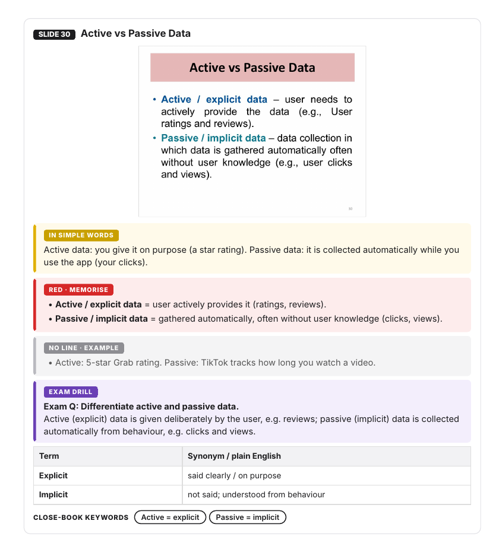

# Lecture Study Notes — Claude Skill (v2)

Turn lecture slides (PDF/PPTX), tutorial sheets and course diagrams into **A4 study-note PDFs** that are easy to revise from.

Every slide gets:
- 🟨 **In simple words**: the slide explained in 1–3 sentences
- 🟥 **Red · Memorise**: definitions, lists, model names (exam material)
- 🟦 **Blue · Understand**: what it's for, why it exists, how it works
- ⬜ **No line · Example**: examples and stories
- 🟧 **Caution**: unclear or wrong slide wording, with the correct version
- 🟪 **Exam drill**: model answers
- 📘 **Terms table**: every professional term with a plain-English meaning
- ⚫ **Close-book keywords**

Each PDF ends with a one-page revision summary and a **Glossary A–Z**.

## Example output

| How to use page | Slide card |
|---|---|
|  |  |

---

## Repository layout

```
lecture-study-notes-skill/
├── README.md
├── assets/
│   └── screenshots/
│       ├── how-to-use.png          ← example output
│       └── slide-card-example.png  ← example output
├── .claude-plugin/
│   ├── plugin.json         ← only needed for Claude Code
│   └── marketplace.json    ← only needed for Claude Code
└── skills/
    └── lecture-study-notes/
        └── SKILL.md        ← the skill itself
```

---

## Option A: Use in Claude (claude.ai web / desktop / mobile)

**Requirements:** a Free, Pro, Max, Team or Enterprise plan, with **Code execution and file creation** turned on.

1. **Download the skill folder**
   - On GitHub, click **Code → Download ZIP**, then unzip it.
   - Open `skills/` and find the folder **`lecture-study-notes`**.
2. **Zip only that folder**
   - Right-click `lecture-study-notes` → *Compress* (Mac) or *Send to → Compressed (zipped) folder* (Windows).
   - The ZIP must contain the folder `lecture-study-notes/` with `SKILL.md` inside it. Don't zip the whole repo.
3. **Turn on code execution**
   - Go to **Settings → Capabilities** and switch on **Code execution and file creation**.
   - Team/Enterprise: an owner must enable this in **Organization settings**.
4. **Upload the skill**
   - Go to **Customize → Skills**, then click **+ → Create skill → Upload a skill**.
   - Choose your ZIP file.
5. **Switch it on**
   - Make sure the **lecture-study-notes** toggle is on.
6. **Use it**
   - Start a new chat and attach your lecture slides (`.pdf` or `.pptx`). Then type, for example:
     > Make study notes for these slides. Course code: WOX7001.
   - Claude builds the PDF and sends it to you.

---

## Option B: Use in Claude Code (terminal)

```bash
# 1. Add this repo as a plugin marketplace
/plugin marketplace add YOUR-GITHUB-USERNAME/lecture-study-notes-skill

# 2. Install the plugin
/plugin install lecture-study-notes@lecture-study-notes-skill
```

Or, without the plugin system, copy the skill folder by hand:

```bash
git clone https://github.com/YOUR-GITHUB-USERNAME/lecture-study-notes-skill
cp -r lecture-study-notes-skill/skills/lecture-study-notes ~/.claude/skills/
```

Restart Claude Code and run `/skills` to check that it's listed.

---

## Tips

- **One PDF per uploaded file.** Upload the lecture slides and the tutorial sheet together, and you get two PDFs.
- **Give the course code.** If it isn't on the slides, the footer leaves it out.
- **Ask about one slide** (e.g. "explain slide 27 with examples") and Claude answers in chat, in the same simple-words style.

## Requirements used by the skill

Claude installs these in its own workspace automatically: `poppler-utils` (pdftotext/pdftoppm), ImageMagick (montage), LibreOffice (for .pptx) and WeasyPrint.

## Changelog

- **v2.0.0**: Added the "In simple words" box, a full Terms table for every slide, the new "How to use these notes" page and a fixed card order.
- **v1.0.0**: First version with 3-colour marking.

## License

MIT
