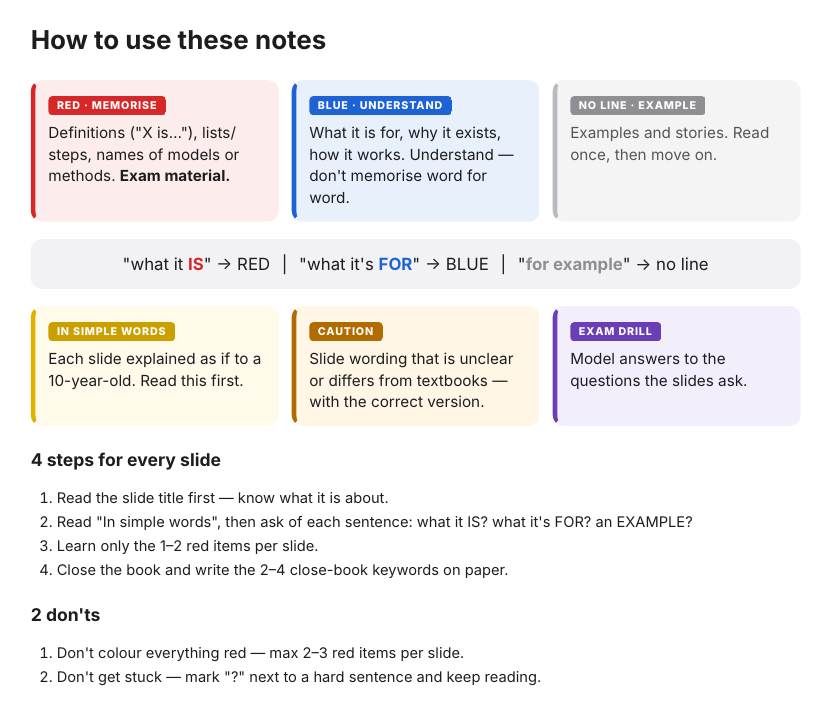

# Lecture Study Notes — Claude Skill (v2)

This repository stores my reusable note-taking workflow built with Claude. I designed a structured, colour-coded template that turns lecture content into clear, exam-friendly revision cards.

It turns lecture slides (PDF/PPTX), tutorial sheets and course diagrams into **A4 study-note PDFs**. Each PDF ends with a one-page revision summary and a **Glossary A–Z**.

---

## How to use these study notes

Every slide card follows the same order, top to bottom:

- 🟡 **IN SIMPLE WORDS**: plain, kid-friendly rephrasing. Read this section first if you find the terminology confusing.
- 🔴 **RED = MEMORISE**: core definitions, formulas, key steps and fixed terminology that you need to recall exactly.
  *Prompt rule: mark what it **IS**.*
- 🔵 **BLUE = UNDERSTAND**: concept explanations, purposes, logic and relationships. You don't need to memorise these word for word.
  *Prompt rule: mark what it's **FOR**.*
- ⚫ **NO-LINE EXAMPLE**: stories and real-life examples, for understanding only. No memorisation needed.
- 🟤 **CAUTION**: ambiguous wording, common misconceptions and differences from textbook definitions.
- 🟣 **EXAM DRILL**: exam-style practice questions with correct reference answers.
- 📘 **TERMS TABLE**: every professional term with a synonym or plain-English meaning.
- ⭕ **CLOSE-BOOK KEYWORDS**: 2–4 keywords to recall from memory.

> Quick rule: "what it **IS**" → 🔴 RED │ "what it's **FOR**" → 🔵 BLUE │ "for example" → ⚫ no line

### 4 steps to study each slide card

1. Read the slide title first to grasp the main topic.
2. Read the simple-words explanation, then ask: What is it? What is it for? What is a real example?
3. Focus only on the 1–2 RED memorisation points per slide.
4. Close the material and write down the 2–4 core keywords from memory.

### 2 things to avoid

1. Don't mark everything red. Highlight at most 2–3 items to memorise on each slide.
2. Don't get stuck on one unclear sentence. Mark it with "?", keep reading and come back later.

---

## Example output

| How to use page | Slide card |
|---|---|
|  |  |

---

## My workflow statement

This is not AI-generated finished work.
I defined the colour rules, card structure and learning logic. Claude acts as an assistant that rephrases and organises content according to my design rules. I do all the review, filtering and final validation myself.

---

## Repository layout

```
lecture-study-notes-skill/
├── README.md
├── assets/
│   └── screenshots/
│       ├── how-to-use.png          ← example output
│       └── slide-card-example.png  ← example output
├── .claude-plugin/
│   ├── plugin.json         ← only needed for Claude Code
│   └── marketplace.json    ← only needed for Claude Code
└── skills/
    └── lecture-study-notes/
        └── SKILL.md        ← the skill itself
```

---

## Option A: Use in Claude (claude.ai web / desktop / mobile)

**Requirements:** a Free, Pro, Max, Team or Enterprise plan, with **Code execution and file creation** turned on.

1. **Download the skill folder**
   - On GitHub, click **Code → Download ZIP**, then unzip it.
   - Open `skills/` and find the folder **`lecture-study-notes`**.
2. **Zip only that folder**
   - Right-click `lecture-study-notes` → *Compress* (Mac) or *Send to → Compressed (zipped) folder* (Windows).
   - The ZIP must contain the folder `lecture-study-notes/` with `SKILL.md` inside it. Don't zip the whole repo.
3. **Turn on code execution**
   - Go to **Settings → Capabilities** and switch on **Code execution and file creation**.
   - Team/Enterprise: an owner must enable this in **Organization settings**.
4. **Upload the skill**
   - Go to **Customize → Skills**, then click **+ → Create skill → Upload a skill**.
   - Choose your ZIP file.
5. **Switch it on**
   - Make sure the **lecture-study-notes** toggle is on.
6. **Use it**
   - Start a new chat and attach your lecture slides (`.pdf` or `.pptx`). Then type, for example:
     > Make study notes for these slides. Course code: WOX7001.
   - Claude builds the PDF and sends it to you.

---

## Option B: Use in Claude Code (terminal)

```bash
# 1. Add this repo as a plugin marketplace
/plugin marketplace add YOUR-GITHUB-USERNAME/lecture-study-notes-skill

# 2. Install the plugin
/plugin install lecture-study-notes@lecture-study-notes-skill
```

Or, without the plugin system, copy the skill folder by hand:

```bash
git clone https://github.com/YOUR-GITHUB-USERNAME/lecture-study-notes-skill
cp -r lecture-study-notes-skill/skills/lecture-study-notes ~/.claude/skills/
```

Restart Claude Code and run `/skills` to check that it's listed.

---

## Tips

- **One PDF per uploaded file.** Upload the lecture slides and the tutorial sheet together, and you get two PDFs.
- **Give the course code.** If it isn't on the slides, the footer leaves it out.
- **Ask about one slide** (e.g. "explain slide 27 with examples") and Claude answers in chat, in the same simple-words style.

## Requirements used by the skill

Claude installs these in its own workspace automatically: `poppler-utils` (pdftotext/pdftoppm), ImageMagick (montage), LibreOffice (for .pptx) and WeasyPrint.

## Changelog

- **v2.0.0**: Added the "In simple words" box, a full Terms table for every slide, the new "How to use these notes" page and a fixed card order.
- **v1.0.0**: First version with 3-colour marking.

## License

MIT
